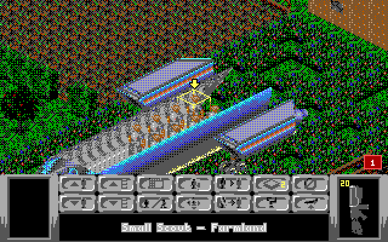
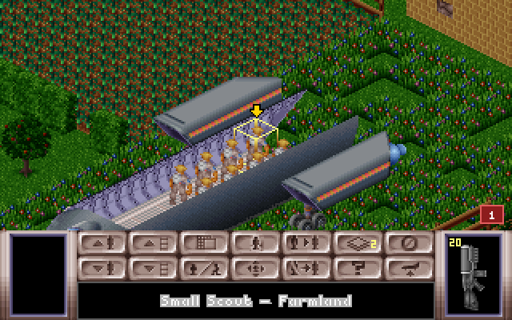
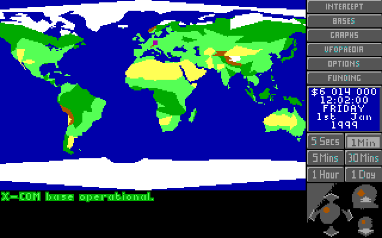
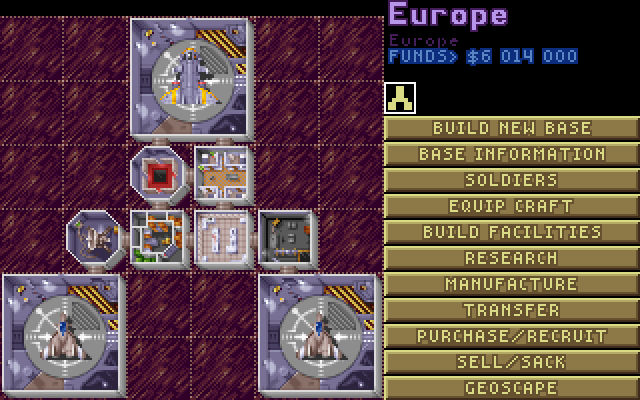
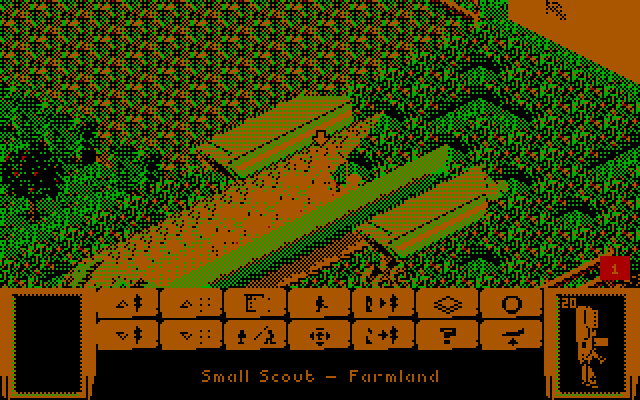
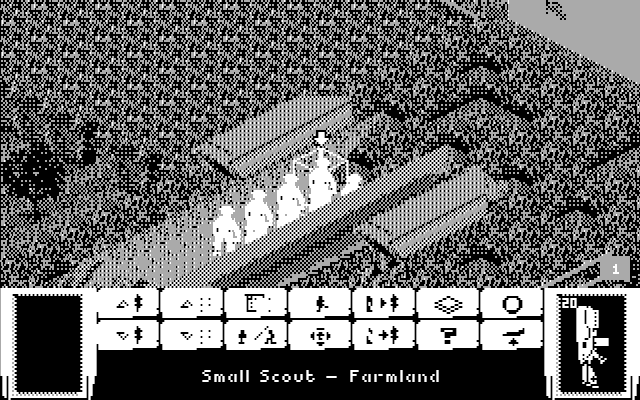

# XCOM-XT

**X-COM: UFO Defense (1994) on an XT.** A new engine, written from scratch, that
plays the whole DOS campaign on a 10 MHz 8088 or NEC V20 with 640 KB and EGA, CGA
or Hercules, and in 256-colour VGA on a 286 or better.

> **Alpha 0.5.1** is the first public build. The campaign plays from the first
> base to Cydonia, but expect bugs, and expect saves and data packs to change
> between versions.

The rules, numbers and screens follow the DOS game (with
[OpenXcom](https://openxcom.org)'s documented rules as the reference). What was
cut to fit an XT is mostly animation: soldiers jump from tile to tile, explosions
are one picture, and the world is a flat map instead of a rotating globe.

| EGA, 16 colours (8088 XT) | VGA, 256 colours (286) |
|---|---|
|  |  |
|  |  |
| **CGA, 4 colours (8088 XT)** | **Hercules, mono (8088 XT)** |
|  |  |

More in [the screenshot gallery](release/screenshots/README.md): every mode's geoscape,
base, battle, alien and inventory screens (taken in the 86Box emulator).

## Playing

The download contains **no game data**. You need your own copy of X-COM: UFO
Defense (the DOS version 1.4: Steam, GOG or the CD).

1. Download `XCOMXT-ALPHA-0.5.1.ZIP` from the
   [Releases](https://github.com/fmikowski/xcom-xt/releases) page.
2. On a Windows PC, run `XCOMCONV.EXE`. It finds your game, or asks for its
   folder, and makes a `PACKS` folder from your own files in a few minutes.
3. Copy the programs, the files in `PACKS` and the mode folder you need (`EGA`,
   `CGA` or `VGA`) to the DOS PC's hard disk, and run `XCOMXT`.

[QUICKSTART.TXT](release/QUICKSTART.TXT) has the short version.
[MANUAL.TXT](release/MANUAL.TXT) has everything else: what works and what is
unfinished, what to expect at each hardware level, memory, sound, launch options,
keys, and the differences from the original.

| | Plain XT | XT with upper memory / EMS | 286+ with VGA |
|---|---|---|---|
| CPU | 8088 / V20, 8-10 MHz | 8088 / V20 | 286, 386, ... |
| Video | EGA, CGA, Hercules | EGA, CGA, Hercules | VGA 256 colours (or EGA) |
| Memory | 640 KB, ~568 KB free for everything | + UMBs and/or an EMS board | + HIMEM.SYS, 256 KB+ XMS free |
| Program | `XCOMXT.EXE` | `XCOMXT.EXE` (`XCOMV20.EXE` on a V20) | `XCOM286.EXE` |

Not tested on real hardware yet: Hercules cards, `XCOMV20.EXE` on a real V20.
Sound Blaster digitised effects need upper memory or XMS (otherwise AdLib-style
FM sound). Most figures in the manual come from the 86Box emulator: reports from
real machines are very welcome.

## Building

The engine is C (Open Watcom 2.0, 16-bit real mode) plus NASM assembly; the
converter is Python. [BUILDING.md](BUILDING.md) is the developer's README: the
layout, the build and the data formats. The design notes, test scripts and
emulator set-ups used during development are not published (yet), so some of
its links lead nowhere.

## Licence

XCOM-XT is free software under the GNU General Public License v3 or later
([COPYING](COPYING)). The converter uses OpenXcom's rule files (GPL v3).
X-COM: UFO Defense is (C) its owners; this project contains none of its data and
is not made or endorsed by them. The packs XCOMCONV makes from your copy of the
game are for your own use: please do not share them.
