# Screenshots

XCOM-XT Alpha 0.5.1 in each video mode, taken in the 86Box emulator: EGA and CGA on
an 8088 XT, Hercules on an 8088 XT with a mono card, VGA on a 286 (`XCOM286.EXE`).
The pictures are the game's own 320x200 (Hercules: 640x200) screens, doubled.

Scenes: a new game's geoscape and first base; a quick battle on farmland (`BATTLE SEED 8
MISSION FA1x.PAK RACE RSx.PAK`) as the squad lands, a sectoid inside the farmhouse, and the
first soldier's inventory. CGA was taken from the emulator and set back to its four
real colours (86Box blends neighbouring pixels).

| | EGA, 16 colours | CGA, 4 colours | Hercules, mono | VGA, 256 colours |
|---|---|---|---|---|
| Geoscape | 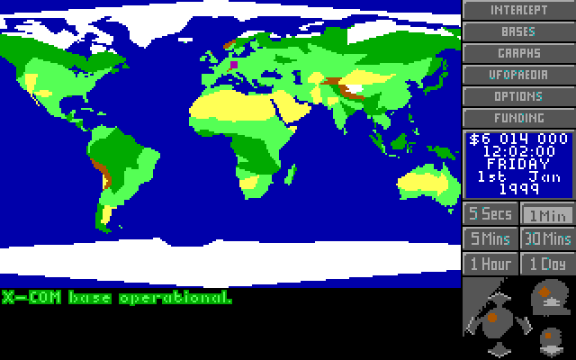 | 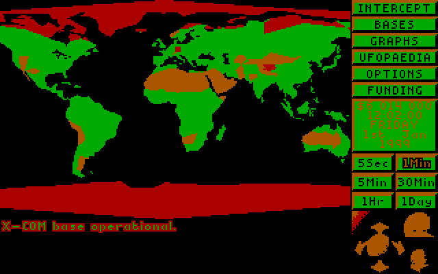 | 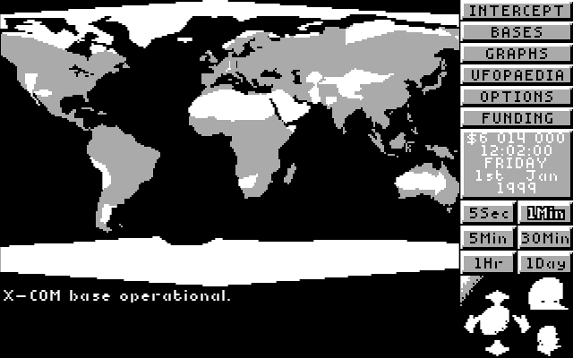 | 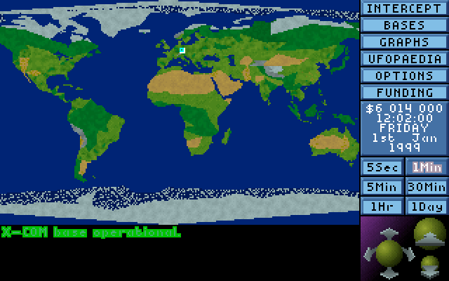 |
| Base | 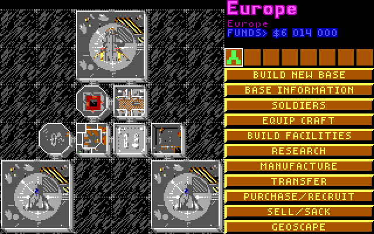 | 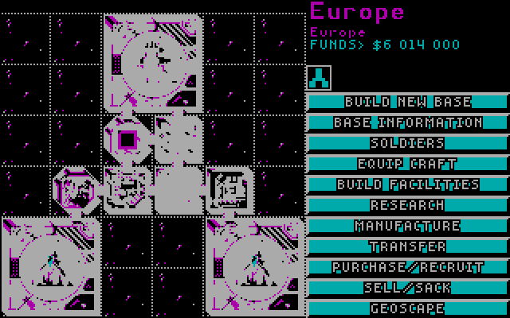 | 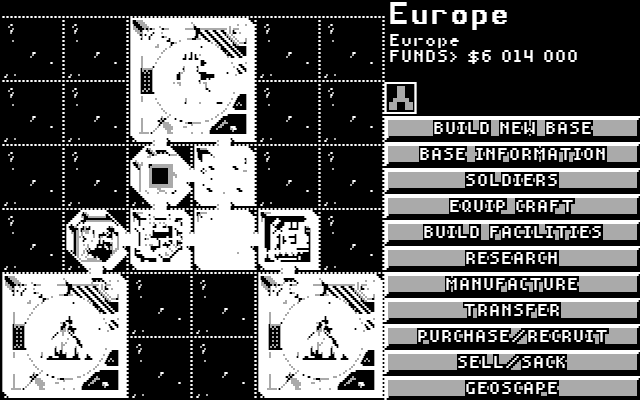 | 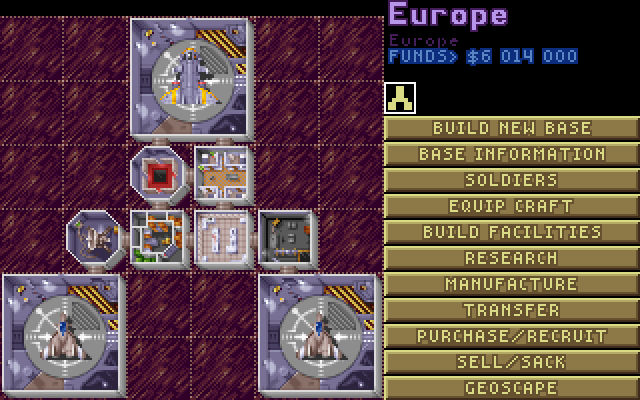 |
| Battle | 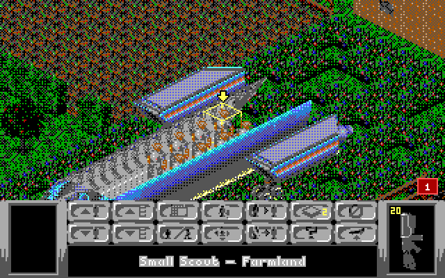 | 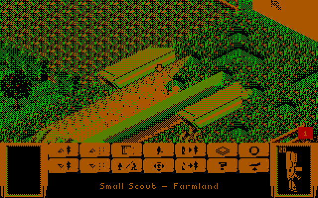 | 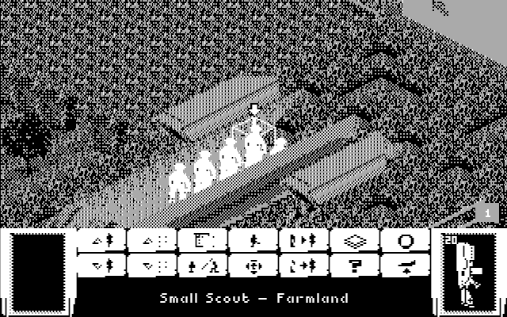 | 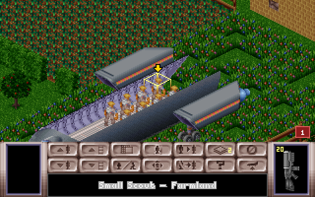 |
| Alien | 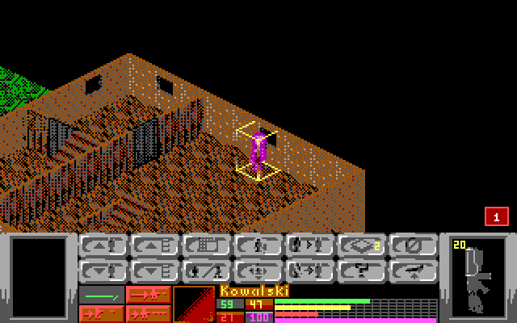 | 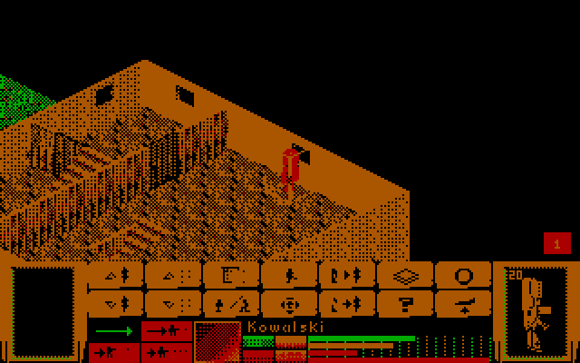 | 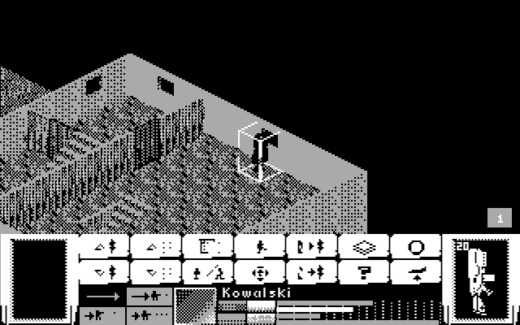 | 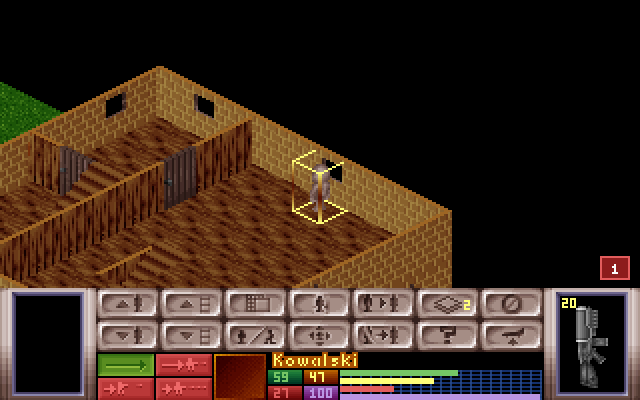 |
| Inventory | 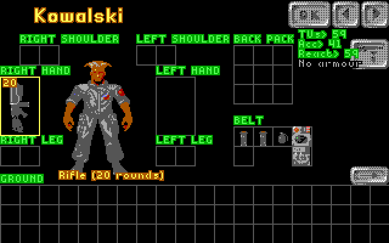 | 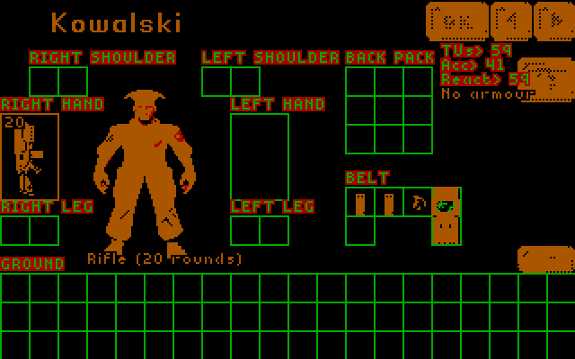 | 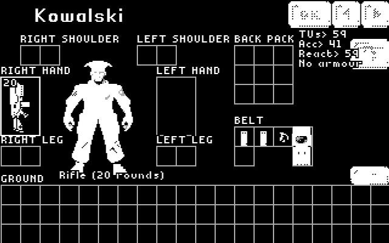 | 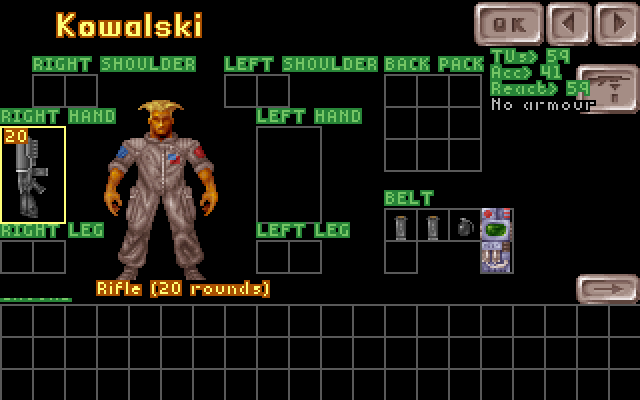 |
